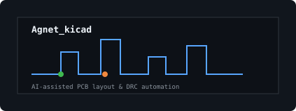
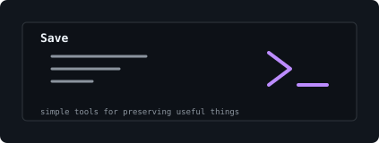
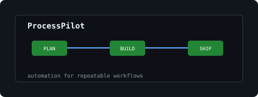
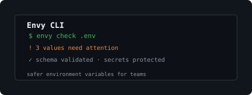
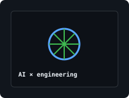
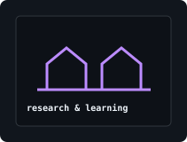

<a href="https://github.com/tad12e">github.com/tad12e</a> &nbsp;·&nbsp; <a href="https://www.linkedin.com/in/tadiwos-getahun-2536ab397">linkedin</a> &nbsp;·&nbsp; <a href="mailto:tadiwos.getahun@gmail.com">email</a>

Building at the boundary between software, electronics, and intelligent automation

  <code>Python</code> · <code>TypeScript</code> · <code>C/C++</code> · <code>Django</code> · <code>React</code> · <code>Flutter</code> · <code>PostgreSQL</code> · <code>KiCad</code>

Electrical and Computer Engineering · Addis Ababa University · Always learning, always building

