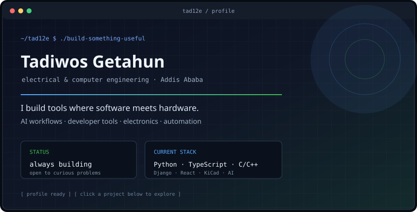
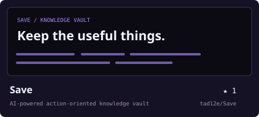
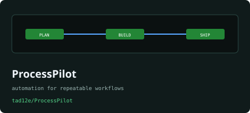
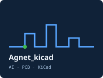
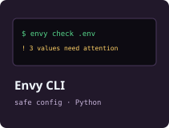
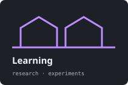
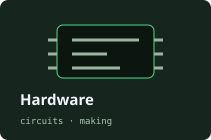
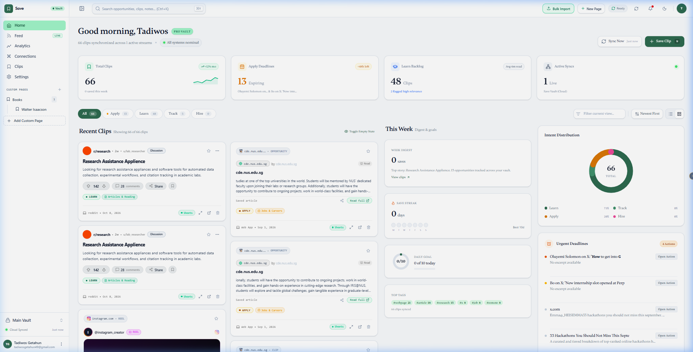
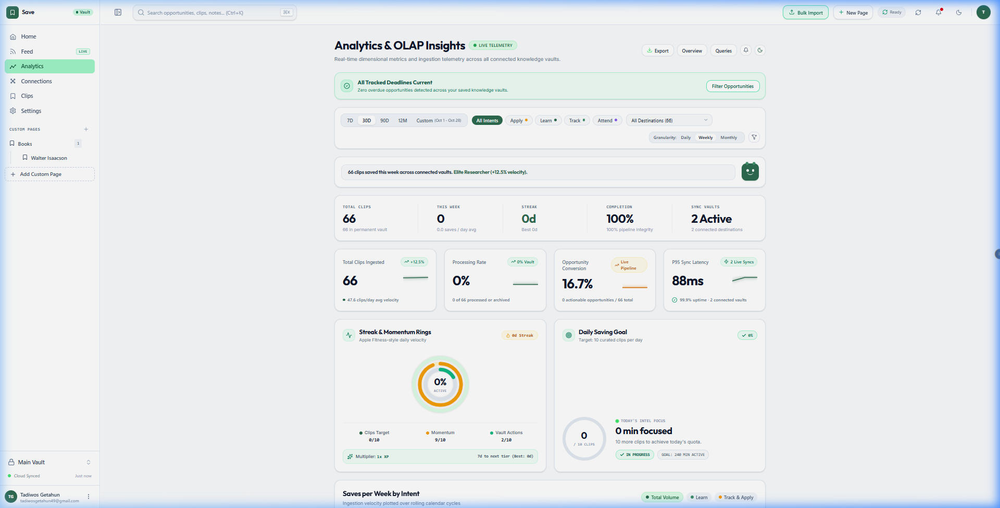

<a href="https://github.com/tad12e">github.com/tad12e</a> &nbsp;·&nbsp; <a href="https://www.linkedin.com/in/tadiwos-getahun-2536ab397">linkedin</a> &nbsp;·&nbsp; <a href="mailto:tadiwos.getahun@gmail.com">email</a>

Building at the boundary between software, electronics, and intelligent automation

Electrical and Computer Engineering · Addis Ababa University · Always learning, always building

